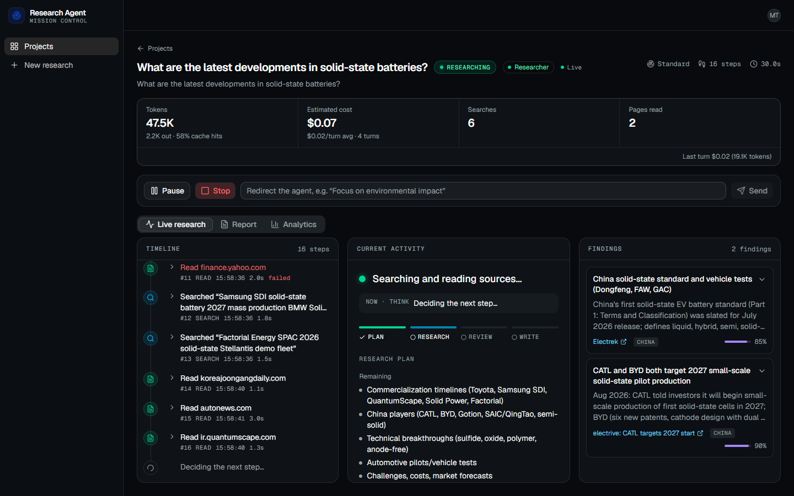
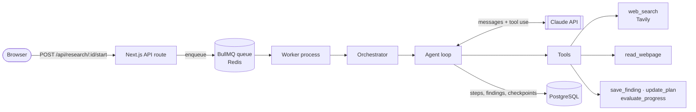
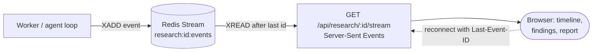
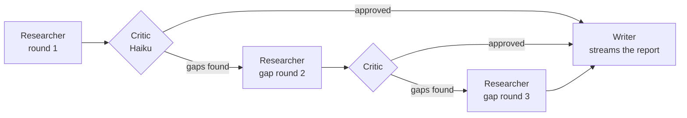
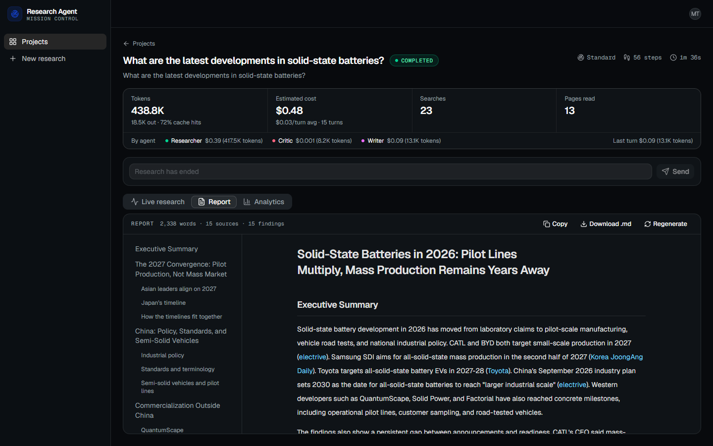
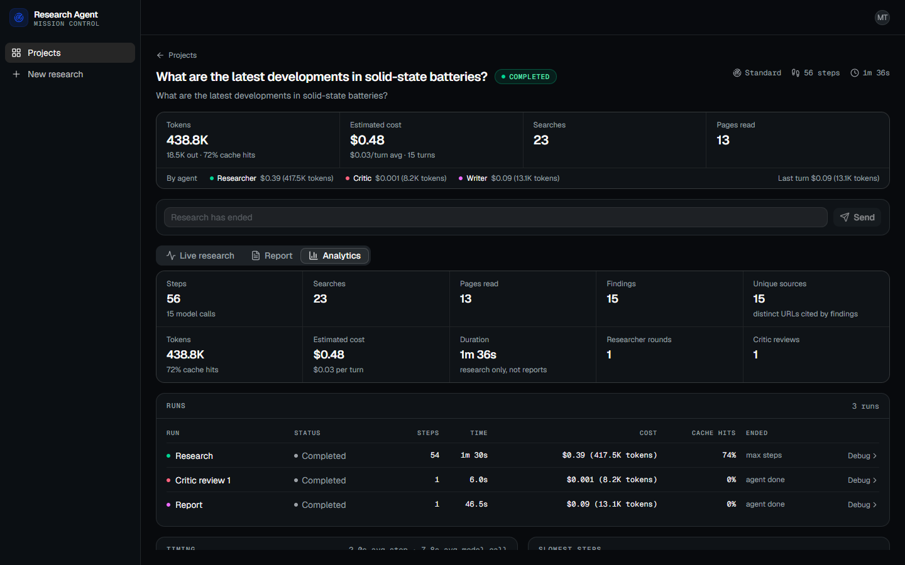
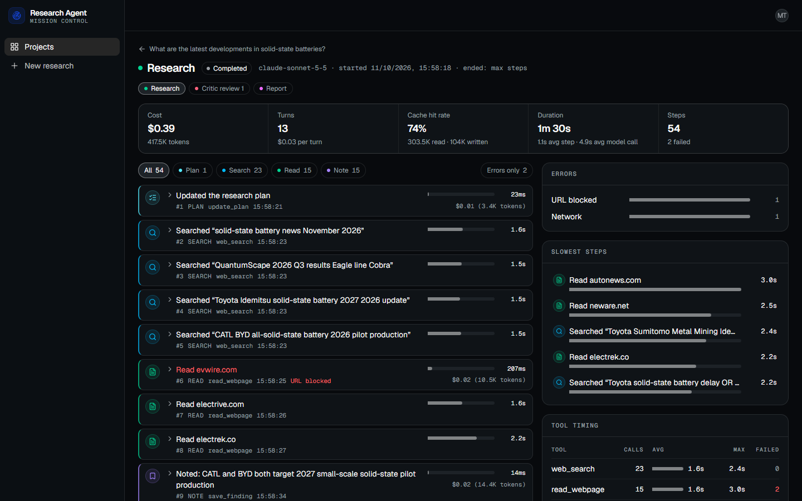
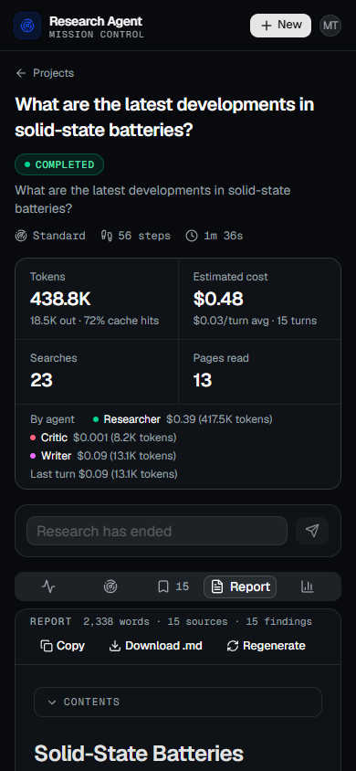

# ResearchAgent

An autonomous AI research agent built with Next.js and Claude.

Give it a topic. Watch it plan, search, read, analyze, and write a comprehensive research report — all on its own.



## Features

- **Autonomous agent loop (ReAct pattern):** Claude decides every next step itself, with tools for searching, reading, note-taking, planning and judging its own progress
- **Multi-step web research:** Tavily search plus a page reader that extracts the article text (Readability, with a Cheerio fallback)
- **Agent memory & context management:** deduplicates repeated searches, reads and findings; summarizes earlier rounds; old tool results are cleared server-side as the conversation grows; prompt caching throughout
- **Real-time streaming progress:** Server-Sent Events backed by Redis Streams, so a reconnecting browser picks up exactly where it left off
- **Human-in-the-loop controls:** pause (with a checkpoint), stop, and redirect the agent mid-run with a new instruction
- **Multi-agent system:** Researcher → Critic → Researcher (gap filling) → Writer
- **Report generation with source citations:** a streamed markdown report with a table of contents; every source is a page the agent actually read
- **Background job execution:** BullMQ + Redis workers; a crashed worker's job continues from its last checkpoint
- **Agent observability & cost tracking:** tokens, cache hits and cost per step and per agent, categorized errors, a step-by-step run debugger, and JSON logs

## AI Agent Concepts Demonstrated

| Concept | Where it lives |
|---|---|
| The agent loop (plan → act → observe → decide → repeat) | [`src/lib/agents/core/loop.ts`](src/lib/agents/core/loop.ts) |
| ReAct pattern (reasoning + acting) | Adaptive thinking on every turn; the reasoning is shown on the timeline next to each action |
| Planning & self-evaluation | `update_plan` and `evaluate_progress` tools ([`src/lib/tools/planning.ts`](src/lib/tools/planning.ts)); the loop refuses to stop before a minimum amount of work |
| Multi-step autonomous tool use (10–50 chained calls) | Per-depth step, cost and time limits ([`src/lib/agents/core/limits.ts`](src/lib/agents/core/limits.ts)) |
| Agent memory / scratchpad | [`src/lib/agents/core/memory.ts`](src/lib/agents/core/memory.ts): dedup, findings, context summaries |
| Human-in-the-loop intervention | Pause/stop/redirect flags in Redis, read at every step boundary ([`src/lib/control/signals.ts`](src/lib/control/signals.ts)) |
| Multi-agent coordination | [`src/lib/agents/orchestrator.ts`](src/lib/agents/orchestrator.ts), [`critic.ts`](src/lib/agents/critic.ts), [`writer.ts`](src/lib/agents/writer.ts) |
| Background execution for long-running tasks | [`src/lib/queue/worker.ts`](src/lib/queue/worker.ts) |
| Agent observability & debugging | [`src/lib/observability/`](src/lib/observability), the Analytics tab and the run debugger |

## Tech Stack

| | |
|---|---|
| Framework | Next.js 16 (App Router, Cache Components), React 19, TypeScript |
| AI | Claude via the Anthropic SDK: Sonnet 5.5 (researcher, writer), Haiku 5.5 (critic) |
| Web search & reading | Tavily, Mozilla Readability, Cheerio, jsdom |
| Database | PostgreSQL 16 + Prisma 7 |
| Jobs & events | Redis 7: BullMQ (job queue), Redis Streams (live events), control flags |
| Auth | NextAuth.js (GitHub OAuth) |
| UI | Tailwind CSS 4, shadcn/ui (Base UI), react-markdown |

## Architecture

### Request → background job → agent

Starting research only enqueues a job; a separate worker process runs the agent, so a run can take minutes without holding an HTTP request open.



### Live progress: worker → browser

Every step is saved to Postgres and published to a Redis Stream. The browser's EventSource reads the stream from a position, so a reload or reconnect continues from the last event it saw instead of starting over.



### The agents: research → review → gap filling → report



The critic reviews at most twice, so research can't loop forever. A gap round starts a fresh conversation seeded with what earlier rounds found and the critic's gaps, and inherits their memory so it doesn't repeat their searches. The pipeline's position is read from the database at every stage, so a resumed or recovered job skips the work that's already done.

## Getting Started

### Prerequisites

- **Node.js** 20.19+, 22.12+ or 24+
- **Docker** (for Postgres and Redis)
- An **Anthropic API key**: [console.anthropic.com](https://console.anthropic.com)
- A **Tavily API key**: free tier at [tavily.com](https://tavily.com) (about 1,000 searches a month)
- A **GitHub OAuth app** for sign-in: [github.com/settings/developers](https://github.com/settings/developers), with the callback URL `http://localhost:3000/api/auth/callback/github`

### Setup

```bash
git clone https://github.com/muhammad-taha-1/research-agent.git
cd research-agent
npm install
docker compose up -d          # Postgres on 5432, Redis on 6379
npm run setup                 # checks your tools and creates .env.local
```

`npm run setup` creates `.env.local` from [`.env.example`](.env.example) with a generated `NEXTAUTH_SECRET`, and lists what's still missing. Fill in `ANTHROPIC_API_KEY`, `TAVILY_API_KEY`, `GITHUB_ID` and `GITHUB_SECRET`, then run it again until everything passes.

```bash
npm run db:migrate            # create the tables
npm run dev:all               # the app on http://localhost:3000, plus the worker
```

Sign in with GitHub and start your first research. The app and the worker are separate processes: `npm run dev` and `npm run worker` start them one at a time.

### Useful commands

| Command | What it does |
|---|---|
| `npm run setup` | Checks Node, Docker, the containers and `.env.local` |
| `npm run dev:all` | Next.js dev server and the worker together |
| `npm run worker` | The worker on its own (restarts on code changes) |
| `npm run db:studio` | Browse the database in Prisma Studio |
| `npx tsx --env-file=.env.local --tsconfig ./tsconfig.json scripts/run-agent.ts "question" QUICK` | Runs a whole research pipeline in the terminal, without the UI or the queue |
| `curl localhost:3000/api/health/worker` | Whether a worker is alive, and the queue's job counts |

Set `AGENT_LOG=full` for the worker's JSON logs uncut, or `AGENT_LOG=off` to turn them off.

## Depths, limits and cost

| Depth | Target work | Limits per run (researcher, round 1) |
|---|---|---|
| Quick | 5–10 searches | 20 tool calls · $0.50 · 5 min |
| Standard | 15–25 searches | 50 tool calls · $2 · 15 min |
| Deep | 30–50 searches | 100 tool calls · $5 · 30 min |

Gap-filling rounds get about half these limits. Measured end to end, researcher, critic and writer together: a Quick run costs about $0.17–0.26 and takes 1–2 minutes; a Standard run about $0.48 and 2–3 minutes. Prompt caching keeps it there: around 70% of input tokens are cache hits. The critic runs on Haiku and costs a fraction of a cent.

## Resilience

- **Claude API errors:** the SDK retries rate limits and 5xx errors with backoff; whatever is left ends the run with a categorized error and keeps the findings.
- **Refusals:** a server-side fallback model takes over; if the response is still refused, the run ends with `endReason: "refusal"` and the findings are kept.
- **Tavily rate limits:** retried after 1s, 2s and 4s. A used-up quota isn't retried; the agent is told to carry on with the sources it has.
- **Unreadable pages:** timeouts, blocked sites and network errors come back to the agent as tool errors, and it moves on to another source.
- **Redis outage:** the agent pauses at its last checkpoint instead of running uncontrolled, and resumes once Redis is back.
- **Worker crash:** the job goes back to the queue and continues from its checkpoint. If a job is lost entirely, the page offers **Resume**.

## Screenshots

| | |
|---|---|
|  |  |
| **Report:** streamed as it's written, with a table of contents and the sources the agent read | **Analytics:** cost, tokens and cache hits per agent run |
|  |  |
| **Run debugger:** every step with its input, result, timing and cost; errors grouped by type | **Mobile:** one panel at a time; two columns on tablets, three on desktops |

## Project structure

```
src/
  app/                    Pages (dashboard, research view, run debugger) and API routes
  components/research/    The research UI: timeline, findings, report, controls, analytics
  hooks/                  Live stream, job health, report generation
  lib/
    agents/               Orchestrator, researcher, critic, writer
      core/               The agent loop, memory, limits, types
    tools/                web_search, read_webpage, save_finding, update_plan, evaluate_progress
    ai/                   Anthropic client, models and settings, prompts, pricing
    queue/                BullMQ queue, worker, stuck-job detection
    stream/               Redis Streams events, SSE formatting, report drafts
    control/              Pause, stop and redirect signals
    observability/        Error categories and JSON logs
prisma/                   Schema and migrations
scripts/                  setup.mjs, run-agent.ts
docs/SPEC.md              The phase-by-phase build spec this project follows
```
